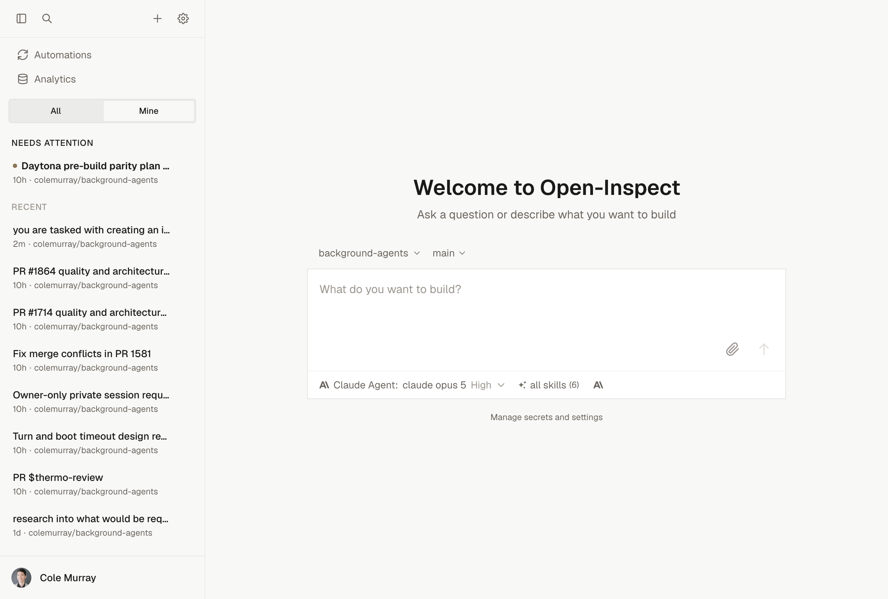

# Background Agents: Open-Inspect

[English](README.md) | [简体中文](README.zh-CN.md)

一个开源的后台编程智能体系统，灵感来自
[Ramp 的 Inspect](https://builders.ramp.com/post/why-we-built-our-background-agent)。

> 本文是英文 README 的简体中文译本。贡献翻译时，请同步核对英文原文，保留命令、配置名称及链接目标。下方链接指向的详细文档目前为英文。修改任一 README 后，可运行
> `node --test scripts/readme-translations.test.mjs`
> 检查章节结构、代码示例和链接是否一致。这些检查不能替代对译文准确性和内容同步情况的人工审阅。



## 概述

Open-Inspect 提供托管的后台编程智能体，可以：

- 在后台处理任务，让你专注于其他工作
- 使用完整的开发环境（Node.js、Python、git、浏览器自动化、VS Code）
- 通过网页界面、Slack、GitHub PR、Linear 议题或 Webhook 随时接入
- 支持多人实时协作的会话
- 创建 PR，并将提交正确归属于发送提示的用户
- 运行基于 cron 的定时自动化，或由 GitHub 事件、Sentry 告警和 Webhook 触发的自动化
- 启动并行子任务，在独立沙箱中同时工作
- 自由选择 AI 模型：Anthropic Claude（通过 API 密钥，或在 Claude
  Agent 执行框架中连接 Claude 订阅）、OpenAI Codex（通过 ChatGPT 订阅）、xAI
  Grok（通过 SuperGrok 订阅）或 OpenCode Zen

## 安全模型（仅支持单租户）

> **重要**：本系统仅为**单租户部署**设计，所有用户都应是同一组织中受信任的成员。团队提供组织内部的访问控制，不提供租户隔离。

### 工作方式

团队拥有会话、环境和自动化。会话的工作区（Workspace）、团队（Team）或私有（Private）可见性与其固定的归属关系相互独立；资源不能在团队之间迁移，也不能在团队与工作区之间迁移。操作团队所属的会话需要当前仍是该团队的成员，即使是工作区所有者（Owner）和管理员（Administrator）也不例外。启用强制执行后，删除操作还要求具有
`sessions.delete`
权限，并且操作者是会话所有者、所属团队负责人或工作区管理员；团队所属会话和私有会话在所有模式下都会检查操作权限。

私有会话仅对其所有者和明确添加的协作者可读。工作区所有者可通过有审计记录的应急通道读取，但不会自动获得协作或沙箱访问权限。团队可见性的读取边界需要设置
`TEAMS_ENFORCEMENT=on`；部署默认值仍为 `shadow`。

对于单团队部署，请先创建一个团队，添加需要操作其会话的用户，并授权访问相应仓库。已有的工作区所属记录不会被迁移或隐藏。即使所有用户都在同一团队，启用强制执行后，普通成员（Member）仍不能删除其他成员的会话，除非满足所有权或负责人规则。邀请用户之前，请先完成
[首个团队的设置](docs/GETTING_STARTED.md#step-10-create-the-first-team-and-test-a-session)。

共享的 GitHub
App 安装范围限定了工作区能够访问的仓库。沙箱 git 凭据仅限于会话持久化记录中的仓库；对于团队所属会话，还会受到该团队当前仓库授权的限制。工作区权限和资源访问规则仍然适用；Open-Inspect 在创建会话前不会核对用户个人的 GitHub 仓库权限。GitLab 凭据仍使用整个部署共享的个人访问令牌（PAT），而非每个会话独立的令牌。

凭据按需获取，但会缓存在磁盘上，因此快照可能保留凭据。移除授权不会立即撤销已签发的令牌。访问规则以[身份认证与授权指南](docs/AUTH.md)为准；另请参阅
[仓库与凭据边界](docs/AUTH.md#repository-and-credential-boundaries)，了解用户身份与 App 身份的区别以及快照限制。

### 为什么仅支持单租户

本架构遵循
[Ramp 的 Inspect 设计](https://builders.ramp.com/post/why-we-built-our-background-agent)，面向内部使用场景，假定所有员工都受信任且能够访问公司仓库。

**如果要进行多租户部署**，则需要：

- 为每个租户单独安装 GitHub App
- 在创建会话时验证访问权限
- 在数据模型中实现租户隔离

### 部署建议

1. **部署在组织的 SSO/VPN 之后**：确保只有获授权的员工能够访问网页界面
2. **仅在目标仓库上安装 GitHub App**：App 的安装范围决定系统能够访问哪些仓库
3. **限制登录**：配置允许登录的 GitHub 用户、邮箱域名或有效的 GitHub 组织成员资格（`ALLOWED_GITHUB_ORGS`）
4. **使用 GitHub 的仓库选择功能**：安装 App 时选择特定仓库，而不是“All repositories”

有关工作区角色、会话访问、自动化归属、机器人和成员停用的说明，请参阅[身份认证与授权](docs/AUTH.md)。

## 架构

```
                                    ┌──────────────────┐
                                    │     Clients      │
                                    │ ┌──────────────┐ │
                                    │ │  Web / Slack │ │
                                    │ │ GitHub / Lin.│ │
                                    │ │   Webhooks   │ │
                                    │ └──────────────┘ │
                                    └────────┬─────────┘
                                             │
                                             ▼
┌────────────────────────────────────────────────────────────────────┐
│                     Control Plane (Cloudflare)                     │
│  ┌──────────────────────────────────────────────────────────────┐  │
│  │                   Durable Objects (per session)              │  │
│  │  ┌─────────┐  ┌─────────┐  ┌─────────┐  ┌───────────────┐    │  │
│  │  │ SQLite  │  │WebSocket│  │  Event  │  │   GitHub      │    │  │
│  │  │   DB    │  │   Hub   │  │ Stream  │  │ Integration   │    │  │
│  │  └─────────┘  └─────────┘  └─────────┘  └───────────────┘    │  │
│  └──────────────────────────────────────────────────────────────┘  │
│  ┌──────────────────────────────────────────────────────────────┐  │
│  │              D1 Database (repo-scoped secrets)               │  │
│  └──────────────────────────────────────────────────────────────┘  │
└────────────────────────────────┬───────────────────────────────────┘
                                 │
                                 ▼
┌────────────────────────────────────────────────────────────────────┐
│                 Data Plane (Sandbox Backend)                       │
│  ┌──────────────────────────────────────────────────────────────┐  │
│  │                     Session Sandbox                          │  │
│  │  ┌───────────┐  ┌───────────┐  ┌───────────┐                 │  │
│  │  │ Supervisor│──│  Harness  │──│   Bridge  │─────────────────┼──┼──▶ Control Plane
│  │  └───────────┘  │ (OpenCode │  └───────────┘                 │  │
│  │                 │ or Claude)│                                │  │
│  │                 └───────────┘                                │  │
│  │                      │                                       │  │
│  │              Full Dev Environment                            │  │
│  │      (Node.js, Python, git, agent-browser)                   │  │
│  └──────────────────────────────────────────────────────────────┘  │
└────────────────────────────────────────────────────────────────────┘
```

## 软件包

| 软件包                                      | 说明                                 |
| ------------------------------------------- | ------------------------------------ |
| [control-plane](packages/control-plane)     | Cloudflare Workers + Durable Objects |
| [web](packages/web)                         | Next.js 网页客户端                   |
| [sandbox-runtime](packages/sandbox-runtime) | 沙箱内共享的智能体运行时             |
| [modal-infra](packages/modal-infra)         | Modal 沙箱基础设施                   |
| [daytona-infra](packages/daytona-infra)     | Daytona 快照基础设施                 |
| [e2b-infra](packages/e2b-infra)             | E2B 沙箱模板基础设施                 |
| [boat-infra](packages/boat-infra)           | Boat 沙箱快照基础设施                |
| [slack-bot](packages/slack-bot)             | Slack 集成（从消息创建会话）         |
| [github-bot](packages/github-bot)           | GitHub 集成（自动审查、@提及）       |
| [linear-bot](packages/linear-bot)           | Linear 集成（议题 → 编程会话）       |
| [shared](packages/shared)                   | 共享类型与工具函数                   |

## 入门

本地开发、参与贡献和部署的实用设置指南，请从 **[docs/SETUP_GUIDE.md](docs/SETUP_GUIDE.md)** 开始。

部署说明请参阅 **[docs/GETTING_STARTED.md](docs/GETTING_STARTED.md)**。

如需了解架构与核心概念，请阅读 **[docs/HOW_IT_WORKS.md](docs/HOW_IT_WORKS.md)**。

如需设置周期性定时任务，请参阅 **[docs/AUTOMATIONS.md](docs/AUTOMATIONS.md)**。

如需创建和使用可复用的智能体指令，请参阅 **[docs/MANAGED_SKILLS.md](docs/MANAGED_SKILLS.md)**。

## 核心功能

### 快速启动

通过多层预热机制，会话几乎可以即时启动：

- **文件系统快照**：每次提示处理结束后保存沙箱状态；后续会话从快照恢复，无需重新克隆仓库
- **预构建镜像**：可按仓库（Settings > Images）或按环境（Settings >
  Environments）启用；每 30 分钟使用最新提交和依赖重新构建
- **主动预热**：你开始输入时沙箱便开始启动，无需等到按下回车键

### 多仓库会话与环境

一个会话可以在同一沙箱中处理多个仓库：

- **临时组合**：在新会话选择器中选择最多 10 个仓库；仓库并排克隆，智能体可以协调修改并为每个仓库创建 PR
- **环境**：将一组仓库保存为命名环境，配置独立的密钥作用域和可选的预构建镜像，然后像选择普通仓库一样从选择器启动
- 环境模型请参阅 [docs/HOW_IT_WORKS.md](docs/HOW_IT_WORKS.md#environments)，环境预构建请参阅
  [docs/IMAGE_PREBUILD.md](docs/IMAGE_PREBUILD.md)

### 托管技能

创建可复用的指令和配套文件，供智能体在会话启动时使用：

- 将共享技能分配到全局，或指定的仓库和环境
- 将常用技能组合保存为个人配置
- 为每个会话固定具体的技能修订版本，确保行为可复现
- 使用指南请参阅 [docs/MANAGED_SKILLS.md](docs/MANAGED_SKILLS.md)

### 多人协作会话

多个用户可以在同一个会话中协作：

- 在线状态指示器显示当前活跃用户
- git 提交归属于发送相应提示的用户
- 向所有已连接的客户端实时推送内容

### 提交归属

提交归属于发送提示的用户：

```typescript
// Configure git identity per prompt
await configureGitIdentity({
  name: author.scmName,
  email: author.scmEmail,
});
```

### 多提供商模型支持

为任务选择合适的 AI 模型，并按会话控制推理强度：

Anthropic 和 OpenAI 模型默认启用。xAI / SuperGrok、OpenCode Zen 和 Go、Z.AI Coding
Plan 以及 DeepSeek 模型需要手动启用。当前的模型 ID、说明和推理强度选项请参阅[可用模型](docs/AVAILABLE_MODELS.md)。

OpenAI 模型可通过 OAuth 使用你现有的 ChatGPT 订阅，无需单独的 API 密钥。Anthropic 模型可以在
**Claude Agent**
执行框架中使用已连接的 Claude 订阅；请参阅[使用 Claude Agent 执行框架](docs/CLAUDE_AGENT.md)。Grok 模型可通过控制平面管理的 OAuth 使用符合条件的 SuperGrok 订阅。订阅设置说明请参阅
**[docs/OPENAI_MODELS.md](docs/OPENAI_MODELS.md)** 或
**[docs/GROK_MODELS.md](docs/GROK_MODELS.md)**。

### 客户端集成

通过团队日常使用的工具与智能体交互：

- **网页界面**：完整的会话管理，支持实时内容推送、模型和推理强度选择器、终端面板及多人在线状态
- **Slack 机器人**：通过 @提及或私信启动会话，可在提示中附加 PNG、JPEG、WebP 和 GIF；结果回复到消息线程。可在 App
  Home 中设置个人模型和分支偏好。请参阅 [Slack 集成](docs/integrations/SLACK.md)
- **GitHub 机器人**：在 PR 创建时自动审查，或响应 PR 评论中的 @提及。可按仓库配置。请参阅
  [GitHub 集成](docs/integrations/GITHUB.md)
- **Linear 机器人**：在议题中提及智能体或将议题分配给它，即可启动编程会话、发布进度并关联最终的 PR。请参阅
  [Linear 集成](docs/integrations/LINEAR.md)
- **Webhook**：通过经过身份认证的 HTTP POST，从任何外部系统触发会话

### 自动化

定时执行周期性任务或响应外部事件，无需人工介入：

- **Cron 定时计划**：支持每小时、每天、每周、每月或自定义五字段 cron 表达式，以及时区设置
- **Sentry 告警**：自动排查新错误、回归问题和关键指标告警
- **GitHub 工作流运行**：在 GitHub Actions 工作流结束时启动任务，可按工作流名称和执行结果筛选
- **入站 Webhook**：通过 JSONPath 条件筛选，控制哪些请求载荷会创建会话
- **多仓库分发**：一个定时自动化最多可覆盖 10 个仓库，为每个仓库创建独立的会话和 PR
- 连续失败 3 次后自动暂停，支持手动触发和完整的运行历史记录

设置说明请参阅 **[docs/AUTOMATIONS.md](docs/AUTOMATIONS.md)**。

### 沙箱环境

每个会话都在隔离的沙箱后端中运行，具备完整的开发环境：

- **预装工具**：Node.js 24、Python 3.12、Bun、git、GitHub CLI、build-essential
- **浏览器自动化**：agent-browser CLI 配合无头 Chromium，用于截图、视觉差异比较和界面验证
- **Code-server**：可选的浏览器版 VS Code，连接到会话工作区
- **网页终端**：通过会话界面访问基于 ttyd 的终端
- **端口隧道**：通过加密隧道暴露最多 10 个开发服务器端口。在 `.openinspect/start.sh`
  运行前，沙箱内的 `/workspace/.tunnels.env`
  已包含相关 URL（[详情](docs/HOW_IT_WORKS.md#tunnel-urls-inside-the-sandbox)）
- **密钥**：使用 AES-256-GCM 加密，可配置全局、仓库或环境作用域，在创建沙箱时作为环境变量注入。支持批量粘贴导入
  `.env`

### 子会话

智能体可以将工作拆分为并行的子会话：

- `spawn-child` 在独立沙箱中创建子会话并立即返回
- 子会话在各自分支上并行运行，父会话可以继续工作
- `send-child-prompt` 向已有的直接子会话排队发送后续指令
- `get-child-status` 和 `cancel-child` 用于协调子会话
- 系统会执行嵌套深度限制和每个仓库的保护规则

### 仓库生命周期脚本

仓库可以在 `.openinspect/` 下定义两个可选的启动脚本：

```bash
# .openinspect/setup.sh (provisioning)
#!/bin/bash
npm install
pip install -r requirements.txt
```

```bash
# .openinspect/start.sh (runtime startup)
#!/bin/bash
docker compose up -d postgres redis
```

- `setup.sh` 在构建镜像和全新会话时运行
- 从预构建镜像或快照恢复启动时跳过 `setup.sh`
- 全新会话中 `setup.sh` 失败不会阻止启动，但在镜像构建模式下会导致构建失败
- `start.sh` 在每次非构建模式的会话启动时运行（全新启动、预构建镜像启动、快照恢复）
- `start.sh` 严格处理失败：如果脚本存在且执行失败，会话启动也会失败
- Open-Inspect 不为这些钩子单独设置超时。脚本仍受整个会话启动预算（`SANDBOX_BOOT_TIMEOUT_MS`，默认为 30 分钟）、外层沙箱关闭限制和镜像构建限制约束；必要时也可以在脚本中为具体命令设置截止时间
- 脚本运行期间会向会话报告进度。失败报告会保留执行阶段、可用的仓库信息以及错误或警告元数据，但钩子的标准输出和标准错误会被丢弃，不会收集或显示。镜像构建没有对应会话，因此两者都不报告。请参阅
  [Open-Inspect 的工作原理](docs/HOW_IT_WORKS.md#fresh-start-no-snapshot)
- 两个钩子都会收到 `OPENINSPECT_BOOT_MODE`（`build`、`fresh`、`repo_image`、`snapshot_restore`）
- 钩子使用的 GitHub 会话凭据仅限于会话已持久化的仓库集合；团队拥有的会话还会与所属团队当前的仓库授权取交集。私有子模块、基于 Git 的依赖和同级仓库克隆所涉及的仓库必须包含在该集合中；仅有 App 安装的访问权限不会扩大此集合
- GitHub 镜像构建凭据仅覆盖构建所涉及的仓库；团队拥有的环境构建还受所属团队仓库授权的限制。GitLab 使用部署级 PAT，不按会话缩小权限范围。关于凭据缓存和授权撤销等详情，请参阅[仓库与凭据边界](docs/AUTH.md#repository-and-credential-boundaries)

## 许可证

MIT

## 致谢

灵感来自
[Ramp 的 Inspect](https://builders.ramp.com/post/why-we-built-our-background-agent)，并使用以下技术构建：

- [Modal](https://modal.com)：云沙箱基础设施
- [Daytona](https://www.daytona.io)：云端开发沙箱
- [Vercel Sandbox](https://vercel.com/docs/vercel-sandbox)：云沙箱基础设施
- [E2B](https://e2b.dev)：云沙箱基础设施
- [Boat](https://boat.dev)：云沙箱基础设施
- [Cloudflare Workers](https://workers.cloudflare.com)：边缘计算
- [OpenCode](https://opencode.ai)：编程智能体运行时（内置执行框架）
- [Claude Agent SDK](https://docs.anthropic.com/en/docs/agent-sdk)：编程智能体运行时（Claude
  Agent 执行框架）
- [Next.js](https://nextjs.org)：Web 框架
