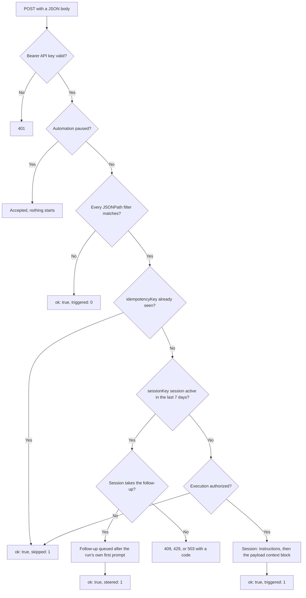

An Inbound Webhook automation gives you a URL and API key; any system that can send a JSON `POST` can start a session.

## How it works

1. Create an automation with **Trigger Type** set to **Inbound Webhook**.
2. After creation, copy the **Webhook URL** and **API Key** shown on the page.
3. Send an authenticated `POST` with a JSON body.
4. OpenInspect checks the request against the automation's conditions and, if they pass, starts a session whose prompt is your saved instructions followed by a context block containing the payload. A delivery with a `sessionKey` can continue the session an earlier delivery started instead; see [Continuing a session](#continuing-a-session).



Webhook automations do not use a schedule or timezone.

## Setup notes

- The **Webhook URL** and **API Key** appear only after the automation is created. The page shows a **Copy** button next to each and a **Copy curl** button that produces a ready-to-run test request.
- The API key is shown once: the form warns you to save it because it is not shown again after you leave the page. Only a hash is stored.
- If the key is lost or leaked, click **Regenerate Key** on the detail page. The old key stops working immediately and the new key is displayed once.
- The detail page always shows the webhook path (`POST /webhooks/automation/<automation-id>`) for reference.

## Request requirements

| Requirement            | Value              |
| ---------------------- | ------------------ |
| Method                 | `POST`             |
| `Content-Type` header  | `application/json` |
| `Authorization` header | `Bearer <api-key>` |
| Maximum body size      | 64 KB              |
| Body                   | Any valid JSON     |

Example:

```bash
curl -X POST "https://<your-worker-url>/webhooks/automation/<automation-id>" \
  -H "Authorization: Bearer <api-key>" \
  -H "Content-Type: application/json" \
  -d '{"event":"deploy.failed","service":"api","environment":"prod"}'
```

## What the agent receives

The session prompt is your instructions, then a separator, then a context block, then a guardrail line telling the agent to treat the context as untrusted. The context block contains:

- A line stating the automation was triggered by an inbound webhook.
- The time the request was received.
- The JSON payload, pretty-printed and truncated after 4,096 characters.
- A warning that the payload is untrusted input data, not instructions.

Write instructions that tell the agent which payload fields matter and what to do with them. For example:

```text
A deployment event has arrived (see the payload below). If `event` is
"deploy.failed", check out the commit named in `sha`, run the test suite,
and open a pull request with a fix if a test fails. Otherwise do nothing.
```

## Filtering with conditions

Webhook automations support one condition type, **JSONPath Filter**. A condition holds one or more filters; every filter must match for the run to start. Add filters with **Add filter** in the condition builder.

### Operators

| Operator (UI) | Stored as  | Matches when                                                    |
| ------------- | ---------- | --------------------------------------------------------------- |
| `=`           | `eq`       | The value equals the filter value                               |
| `!=`          | `neq`      | The value differs from the filter value                         |
| `>`           | `gt`       | The value is a number greater than the filter value             |
| `>=`          | `gte`      | The value is a number greater than or equal to the filter value |
| `<`           | `lt`       | The value is a number less than the filter value                |
| `<=`          | `lte`      | The value is a number less than or equal to the filter value    |
| `contains`    | `contains` | The value is a string containing the filter text                |
| `exists`      | `exists`   | The path resolves to any value                                  |

A missing path fails every operator except `exists`. When you type a numeric value in the filter box it is stored as a number, so `$.count = 3` compares against the number 3, not the string "3".

### Path syntax

Paths are simple dot notation starting with `$.`, for example `$.event.type` or `$.deployment.environment`.

Not supported:

- Array indexing such as `$.items[0]`
- Recursive descent such as `$..id`
- Filter expressions or any other full JSONPath syntax

### Examples

| Goal                                    | Path                    | Operator   | Value        |
| --------------------------------------- | ----------------------- | ---------- | ------------ |
| Run only for production                 | `$.environment`         | `=`        | `production` |
| Run only for failed deploys             | `$.status`              | `=`        | `failed`     |
| Run only when a field is present        | `$.pull_request.number` | `exists`   | (none)       |
| Run only for severe alerts              | `$.severity`            | `>=`       | `3`          |
| Run when the message mentions a service | `$.message`             | `contains` | `checkout`   |

## Idempotency and duplicate deliveries

If your sender may retry, include a top-level `idempotencyKey` string in the body.

- Deliveries that share an `idempotencyKey` are treated as the same event. Re-sending it does not create a second run; the duplicate is counted as skipped and returns the original delivery's `invocationId`, even while that run is still in progress.
- The `idempotencyKey` stays in the stored body but is removed from the context block the agent sees.
- Without an `idempotencyKey`, every delivery gets its own key, so separate deliveries to the same automation can run concurrently.

## Continuing a session

To send several deliveries to one session, include a top-level `sessionKey` string in the body. The first delivery with a key starts a run as usual. A later delivery with the same key is queued as a follow-up prompt on that run's session instead, whether the run is still starting, working, or finished, as long as the session was active within the last 7 days. The follow-up is the payload's context block; the saved instructions are not repeated.

- Conditions still apply. A delivery that fails them does nothing.
- The follow-up is sent as the automation's executor, who must be able to collaborate on the session. Without that access the delivery counts as skipped and nothing starts.
- `sessionKey` stays in the stored body but is removed from the context block. It must be a non-empty string of at most 256 characters; anything else is rejected with `400`.
- Pair it with an `idempotencyKey` so retries are safe: the session recognizes a retried follow-up and the delivery counts as skipped.
- A follow-up that arrives while the first run is still starting is held and queued right after the run's own first prompt. It counts as steered.
- Two deliveries with a new key that arrive at the same moment do not start two runs: one starts the run and the other is skipped for concurrency.
- If the session will not take the follow-up, for example because it was archived or ran out of budget, the request fails with an [error response](#error-responses) instead of starting over in a new session.
- After 7 days without activity in the session, the next delivery starts a new run, and later deliveries continue that one.

## Responses

A successful request returns:

```json
{ "ok": true, "triggered": 1, "skipped": 0, "steered": 0, "invocationId": "3f2a…" }
```

| Field          | Meaning                                                                                                                                                                                                                                                           |
| -------------- | ----------------------------------------------------------------------------------------------------------------------------------------------------------------------------------------------------------------------------------------------------------------- |
| `triggered`    | Runs started by this delivery                                                                                                                                                                                                                                     |
| `skipped`      | Runs not started because of duplicate delivery, concurrency protection, or runtime authorization denial                                                                                                                                                           |
| `steered`      | Follow-ups routed into an existing session: Slack thread replies, and webhook deliveries whose `sessionKey` matches a recent run                                                                                                                                  |
| `invocationId` | The firing this delivery belongs to: new, recorded as skipped for concurrency, the original for a duplicate `idempotencyKey`, or the run's own for a follow-up routed into its session. `null` when nothing was recorded. See [Checking status](#checking-status) |

A request whose conditions do not match returns `ok: true` with `triggered: 0`.

Runtime authorization denial returns `ok: true` with `triggered: 0` and `skipped: 1`, not `401`. It does not pause the automation or record a run-history invocation. Restore the required executor/team/target access before sending another delivery; **Resume** is not needed unless the automation was separately paused.

### Error responses

| Status | Meaning                                                                                                                                                |
| ------ | ------------------------------------------------------------------------------------------------------------------------------------------------------ |
| `400`  | Invalid JSON body, or a `sessionKey` that is not a non-empty string of at most 256 characters                                                          |
| `401`  | Missing or invalid API key                                                                                                                             |
| `404`  | Automation not found, or not an Inbound Webhook automation                                                                                             |
| `409`  | A `sessionKey` follow-up the session cannot take: `SESSION_NOT_PROMPTABLE` (archived or cancelled), `BUDGET_EXHAUSTED`, or `SANDBOX_RECOVERY_REQUIRED` |
| `413`  | Body larger than 64 KB                                                                                                                                 |
| `415`  | `Content-Type` was not `application/json`                                                                                                              |
| `422`  | A `sessionKey` follow-up the session rejected for another reason; a retry is rejected the same way                                                     |
| `429`  | A `sessionKey` follow-up whose session queue is full (`PROMPT_QUEUE_FULL`)                                                                             |
| `503`  | A `sessionKey` follow-up whose session could not be reached (`SESSION_UNAVAILABLE`). Retrying with the same `idempotencyKey` is safe                   |

A refused follow-up returns `{ "error": "…", "code": "…", "invocationId": "…" }`, where `invocationId` is the run whose session refused it. Nothing new starts. To start over in a new session, send a different `sessionKey`.

A paused automation accepts the request but starts nothing.

## Checking status

Keep the `invocationId` from the response to follow the work without signing in to the web app. Read it with the same API key:

```bash
curl "https://<your-worker-url>/webhooks/automation/<automation-id>/invocations/<invocation-id>" \
  -H "Authorization: Bearer <api-key>"
```

```json
{
  "invocationId": "3f2a…",
  "status": "running",
  "runs": [{ "id": "9c1e…", "status": "running", "sessionId": "sess_…" }]
}
```

- `status` is the invocation's overall status: `starting`, `running`, `completed`, `failed`, `partial_failed`, `unauthorized`, or `skipped`.
- Each run's `sessionId` stays `null` until its session is created. Use it to link people to the session in the web app, where normal sign-in and session access rules apply.
- The endpoint returns only status. It never returns the session conversation, the payload, or the automation's other history.
- It returns `404` for an unknown ID, an invocation belonging to another automation, or a firing this webhook did not cause (such as a manual **Run now**).

## Security

- Treat the API key like a password. Anyone holding it can submit events that start sessions against the automation's repository under the stored executor's authority, subject to conditions and runtime authorization. Use **Regenerate Key** if it is exposed.
- The payload reaches the agent as untrusted data inside the prompt. Keep instructions specific about which fields to act on, and do not ask the agent to follow instructions contained in the payload.
- Runs execute with the stored executor's permissions; the sender's identity is not checked beyond the key. For team automations, the executor must still belong to the active owning team, and current repository grants must cover the target. The key does not bypass these checks. Created sessions inherit the owning team and its default visibility; see [Ownership and execution](/automations/first-automation#ownership-and-execution).

## Troubleshooting

| Symptom                       | Cause                                                                                                                  | Fix                                                                                                                                                                    |
| ----------------------------- | ---------------------------------------------------------------------------------------------------------------------- | ---------------------------------------------------------------------------------------------------------------------------------------------------------------------- |
| `401`                         | Missing `Authorization: Bearer` header, or the key was regenerated                                                     | Copy the current key from the detail page; regenerate if it is lost                                                                                                    |
| `415`                         | The `Content-Type` header is missing or not `application/json`                                                         | Set the header explicitly; some HTTP clients default to form encoding                                                                                                  |
| `404`                         | Wrong automation id, or the automation uses a different trigger type                                                   | Copy the URL from the detail page                                                                                                                                      |
| `ok: true` but `triggered: 0` | A filter did not match, the automation is paused, or the delivery was skipped (including runtime authorization denial) | Check filters and status; if `skipped: 1`, check duplicates/concurrency and the executor's active status, permissions, team membership, active team, and target grants |
| Retries create no run         | The retry reused an `idempotencyKey` that already fired                                                                | Expected; use a new key for a genuinely new event                                                                                                                      |
| `409` for a `sessionKey`      | The session that key continues was archived, cancelled, ran out of budget, or needs sandbox recovery                   | Restore or recover the session in the web app, or send a new `sessionKey` to start a fresh session                                                                     |

## Next steps

- [Sentry alerts](/automations/sentry-alerts)
- [GitHub event triggers](/automations/github-events)
- [Secrets](/configure/secrets)
