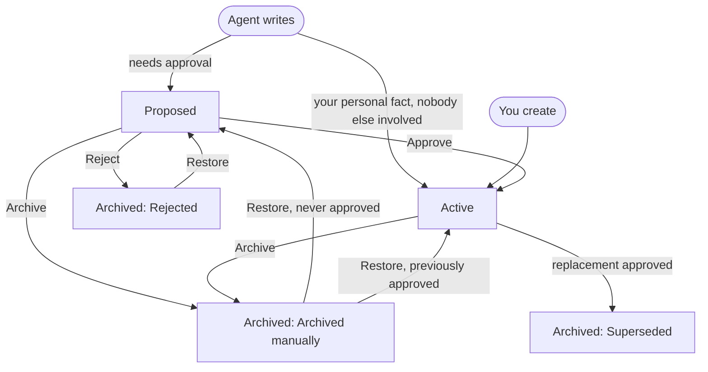

Memories carry useful knowledge from one session to the next without changing repository files: a correction you gave the agent, a standing preference such as how you like commit messages written, or a hard-won fact about a repository that isn't written down anywhere. You manage your own under Settings › Memories, and repository and environment memories under Settings › Shared memories.

Agents can propose memories as they work. Apart from one narrow case for personal facts, nothing an agent writes is used by other sessions until a person approves it.

<Callout type="warn" title="Memories are context, not secrets">
  Memory content is given to the agent as text and can appear in its responses. Never store
  credentials in a memory. Anything the agent writes from your personal memories appears in the
  session, where anyone who can see the session can read it.
</Callout>

## Facts and directives

Every memory is one of two types.

| Type      | Shown in the editor as      | How a session uses it                                                                                                        |
| --------- | --------------------------- | ---------------------------------------------------------------------------------------------------------------------------- |
| Fact      | Fact · read when relevant   | The title and description go into a catalog the agent sees at start. The agent reads the full content only when it needs it. |
| Directive | Directive · always included | When selected for a session, the full content is given to the agent at the start, like a custom instruction.                 |

Use facts for knowledge that matters only sometimes; use directives sparingly, for rules that should apply to every session. The description is what the agent uses to decide whether a fact is relevant, so make it specific.

## Scopes and who can manage them

| Scope       | Loaded into                                                                          | Who can see it                                                                                                              | Who can create, edit, approve, and archive                                                                                                                                           |
| ----------- | ------------------------------------------------------------------------------------ | --------------------------------------------------------------------------------------------------------------------------- | ------------------------------------------------------------------------------------------------------------------------------------------------------------------------------------ |
| Personal    | Your web and Slack DM sessions, [read on your prompts](#including-personal-memories) | You, in Settings; Administrators and Owners cannot open another person's. What a session loads can reach its other readers. | You, with `memories.manage_own` (Members, Administrators, and Owners).                                                                                                               |
| Repository  | New sessions that include the repository                                             | Anyone who can read the repository, including Viewers                                                                       | Owners and Administrators (`repositories.settings.manage`). Another role with that permission must also lead an active team that holds a grant for the repository, if any team does. |
| Environment | New sessions launched from the environment                                           | Anyone who can read the environment                                                                                         | People with management access to the environment and `environments.settings.manage`.                                                                                                 |

Settings › Memories appears for anyone who can create sessions or manage personal memories. Settings › Shared memories appears for anyone who can read repositories or environments; people without management access see shared memories read-only. See [Workspace access](/administration/workspace-access) for roles and team grants.

## How agents use memories in a session

When a session is created, OpenInspect selects the active memories that apply to it and pins them for the session's lifetime. The session's "Loading memories" boot phase puts them in the agent's context before it starts.

- Directives are included in full. Facts appear as a catalog of titles and descriptions.
- The agent has three memory tools: `memory_search` finds active facts by keyword, including facts that did not fit in the catalog; `memory_read` reads a fact's current content; and `memory_write` saves or proposes a new memory.
- Agents are told that most sessions should save nothing. They save a memory when you ask them to remember something, correct them, state a standing preference, or confirm a non-obvious approach, or when they verify a hard-won fact that the repository doesn't record and that would change what the next session does first. They skip work summaries, status, fixes already in the code, anything the repository already says, sandbox quirks, and guesses, and they check for an existing memory to update before writing. They write a directive only when you ask them to remember a preference.
- Editing or archiving a memory does not change text already given to a running session. Start a new session to pick up changes.
- Child sessions inherit their parent's selection. A child started on someone else's prompt leaves out the parent owner's personal memories.

If a session holds more than fits, whole records are left out: at most 100 directives (6,000 characters per scope, 12,000 in total) and 200 catalog facts (24,000 characters of titles and descriptions). Environment memories come first, then each repository in session order, then personal memories. A top-level session can still find and read an active fact that was left out by searching for it.

### See what a session loaded

Expand Memories in the session's right sidebar. It groups the pinned memories by repository, environment, or Personal scope. Hover over or focus a row for its revision, how it was included, and an estimated token count. A row marked "revised" or "archived" changed after the session started. The footer shows the total estimate, whether personal memories were included, and how many records were omitted for budget. Each row links to the memory in Settings. Personal memories are listed only for the session owner; everyone else sees how many there are.

## Including personal memories

Your personal memories work for you, not for whoever is using a session. Settings › Memories has a **Use my personal memories in my sessions** switch, on by default.

- **Which sessions include them.** New sessions you start on the web or in a Slack direct message. Automation runs, including ones you trigger yourself, never include them, and neither do sessions started from a Slack channel, from Linear, or from GitHub.
- **Only your own prompts use them.** While the agent works on your prompt, it can search, read, and save your personal memories. While it works on someone else's prompt, or an automatic one such as Autofix, it cannot. The personal directives and catalog loaded when the session started stay in the agent's context for every prompt.
- **Someone else's prompt ends searching.** A prompt can leave a program running in the sandbox, so once someone else has prompted the session, or a session that started it, the agent stops searching and reading your personal memories there for good. Your later prompts can still save new ones for you to review.
- **Turning the switch off** reaches existing sessions too: their agents stop searching, reading, and saving your personal memories at once. What a session loaded when it started stays in its context.
- **Sessions prompted before these rules** keep the personal memories they loaded, automation runs and Slack channel, Linear, or GitHub sessions included. Their earlier prompts count as someone else's, so their agents no longer search or read your personal memories, and what they save waits for your review.

Session visibility changes none of this: a team- or workspace-visible session you prompt yourself uses your personal memories exactly as a private one does.

What this does not stop: anything the agent writes from your personal memories appears in the session, where everyone who can see it can read it. The directives and catalog loaded at the start shape every prompt, and they sit in the sandbox's files, where anyone who opens its terminal can read them. Anyone who can open a session's terminal, editor, or desktop can do what its agent can, so while your prompts run they can also search and read the rest of your personal memories and save new facts, just as they can use the session's other credentials.

Sessions use your personal memories only while you have `memories.manage_own`, so agents never save memories you cannot review. If your role loses it, new sessions don't include your personal memories, and agents can no longer search, read, or save them. Unlike turning the switch off, it also leaves the personal directives and catalog out of an existing session's context the next time its sandbox starts; the session keeps running without them.

## How agent proposals are approved

Memories you create in Settings are active immediately. What an agent writes depends on the type and scope.

| Agent writes                     | Result                                                                                                                             |
| -------------------------------- | ---------------------------------------------------------------------------------------------------------------------------------- |
| Personal fact                    | Active immediately on your own prompt in a top-level session, until someone else prompts it. Otherwise proposed for you to review. |
| Personal directive               | Proposed for you to review.                                                                                                        |
| Repository or environment memory | Proposed for someone who can manage that scope.                                                                                    |

Once someone else prompts a session, the personal facts it saves are always proposed. Sharing the session or adding a collaborator does not change this by itself. Child sessions never save personal facts directly. An agent's personal fact that replaces a directive is always proposed, so a directive cannot be replaced without your approval. When an agent proposes a memory, it is instructed to tell you that it awaits review in Settings › Memories (personal) or Settings › Shared memories.

Each session can make at most 20 memory writes, with at most 5 proposals pending at a time.

## Browsing memories

Both settings pages share the same list controls.

- **Proposed, Active, and Archived** tabs filter by status. Active is selected by default. Archived records show why they were archived: Archived manually, Rejected, or Superseded, with any archive note.
- **Search** filters by title, description, and content. Type at least 2 characters and at most 8 words; every word must appear somewhere in the memory. The search text is kept in the page URL; a copied link restores the search, but the tab, page, and any scope chosen in **Memory scope** may need to be selected again.
- **Previous page** and **Next page** move through 50 records at a time, most recently updated first.
- Each record shows its type, revision number, and whether it is User-authored or came from an **Agent session** (a link to the session that wrote it).

### The All view in Shared memories

Settings › Shared memories opens on **All**, which lists memories from every repository and environment you can read, in one list. Each record shows its scope. Environment scopes link to that environment's own view. Repository scopes are shown as text; choose the repository in **Memory scope** to see only its memories.

To review everything waiting for approval, open the Proposed tab in All. You can edit, approve, reject, archive, and restore from All wherever you have management access, but you cannot create or supersede a memory there.

The All view stops paging once a page would start past the 1,000th record. If more matches remain, it says "All-view browsing limit reached"; choose a single scope or narrow your search.

Use **Memory scope** to switch between All and a single repository or environment. The picker is searchable and groups options under Repositories and Environments.

## Creating a memory

1. Open Settings › Memories for a personal memory. For a shared memory, open Settings › Shared memories and choose a repository or environment in **Memory scope**. **New memory** does not appear in All, or if you cannot manage the scope.
2. Click **New memory**.
3. Choose **Fact** or **Directive**.
4. Enter a **Title** (up to 200 characters) and a **Description** (10 to 420 characters) that helps the agent decide when the memory is relevant.
5. Enter the **Content**: up to 20,000 characters for a fact or 2,000 for a directive.
6. Click **Save memory**.

The memory is active immediately and is selected for new sessions it applies to, within the [session budget](#how-agents-use-memories-in-a-session).

## Editing, superseding, and history

- **Edit** changes a proposed or active memory. Each save creates a new revision; the original author is kept. Archived memories cannot be edited until they are restored.
- **Supersede** on an active memory opens a new memory that replaces it. In Settings › Shared memories, choose the repository or environment in **Memory scope** first; Supersede is not available in All. When you save, the new memory becomes active and the old one is archived as Superseded. When an agent proposes a replacement, the original stays active until the proposal is approved.
- **Revision history** shows each revision with a before-and-after comparison. **Revert to this revision** saves that content as a new revision; history is never rewritten.

## Approving, rejecting, archiving, and restoring

| Button  | Applies to       | What happens                                                                                                                                              |
| ------- | ---------------- | --------------------------------------------------------------------------------------------------------------------------------------------------------- |
| Approve | Proposed         | The memory becomes active. If it replaces another memory, that memory is archived as Superseded.                                                          |
| Reject  | Proposed         | The memory is archived as Rejected.                                                                                                                       |
| Archive | Proposed, Active | Asks for an optional **Archive note**, then **Confirm archive**. New sessions omit the memory; text already given to a running session cannot be removed. |
| Restore | Archived         | A memory that was never approved returns to Proposed. A memory that was approved returns to Active.                                                       |

There is no delete. Archive a memory to take it out of use; it stays under Archived, with its history, and can be restored.

## Acting on several memories at once

When a page has records you can act on, a bar above the list lets you select them.

1. Tick the checkbox on each record, or **Select all on this page**. Only records you can manage have a checkbox.
2. Click an action such as **Approve selected** or **Archive selected**. Only actions that every selected record allows are offered.
3. **Reject selected** and **Archive selected** ask for an optional **Archive note for all selected**, then a confirmation such as **Archive 3 memories**. Approve and restore apply immediately.

Selection is limited to the current page and clears when you change the tab, page, or search. Each memory is checked separately against your access and against the revision you were looking at, so one whose content was revised, whose current status no longer allows the action, or that you cannot manage fails on its own while the rest apply. The page reports the outcome, for example "Approved 5 of 7 memories." followed by each failure by title with its reason.

The server accepts up to 8 memories per request. The page sends larger selections as consecutive batches of 8 automatically. If a whole batch fails, for example because the connection dropped, that batch and any batches not yet sent are reported as failed, and earlier batches stay applied. The server may still have applied the failed batch before its response was lost, so reload and check each memory's current status before retrying.

## Troubleshooting

<Accordions>
  <Accordion title='"Memory changed" or "Memory status changed; reload before acting"'>
    Cause: someone else revised the memory's content after you loaded it, or its status changed so
    that your action no longer applies (for example it was archived, or a proposal you tried to
    approve was already rejected). Edits and actions apply only to the content revision you
    reviewed, so your change is refused rather than overwriting theirs. A status change alone does
    not block an action the new status still allows: editing or archiving a proposal that someone
    has since approved applies to the now-active memory. Fix: reload the page, review the current
    version, and try again.

</Accordion>
  <Accordion title="Some memories failed in a bulk action">
    Cause: each selected memory is decided separately. A memory fails on its own when its content
    was revised since you loaded it, its current status no longer allows the action, or you cannot
    manage its scope. The error lists each
    failed memory by title with the reason. Fix: reload, then select the remaining memories and
    try again.

</Accordion>
  <Accordion title="Restore or approve fails with “another replacement is active”">
    Cause: a previously approved memory cannot become active again while another memory that
    replaced it is active, and a replacement cannot be approved after the memory it replaces has
    changed or been archived. Restoring a proposal also fails if the agent session that wrote it
    already has 5 pending proposals. Fix: archive the active replacement first, or review the
    memory it replaces and propose a new replacement.

</Accordion>
  <Accordion title="New memory is missing">
    Cause: All is selected in Settings › Shared memories, or you cannot manage the selected scope.
    Fix: choose a repository or environment in **Memory scope**. If the button is still missing,
    ask an Owner, Administrator, or team lead with access to manage that scope.

</Accordion>
  <Accordion title="A memory change is not visible in a running session">
    Cause: memories are pinned when a session is created. Fix: start a new session. A running
    session's agent can still read an active fact's current content with `memory_read`; an archived
    fact returns only an archive notice.

</Accordion>
  <Accordion title="A memory is not loaded in a new session">
    Check that it is Active, not Proposed or Archived; that the session includes its repository
    or environment; and, for personal memories, that **Use my personal memories in my sessions**
    is on and that you started the session on the web or in a Slack direct message. If the
    sidebar shows records "omitted for budget", the session held more memories than fit; shorten
    or archive directives, or tighten fact descriptions.

</Accordion>
  <Accordion title="The agent says personal memory is unavailable">
    Cause: the agent is working on someone else's prompt; someone else has prompted the session,
    or one that started it; the session was started by an automation or an integration other than
    a Slack direct message; or your personal memory switch is off. Fix: turn the switch on if it's
    off, then start a new session and prompt it yourself.

</Accordion>
</Accordions>

## Next steps

- [Managed skills](/configure/managed-skills)
- [Environments](/configure/environments)
- [The session page](/sessions/session-page)
- [Workspace access](/administration/workspace-access)
